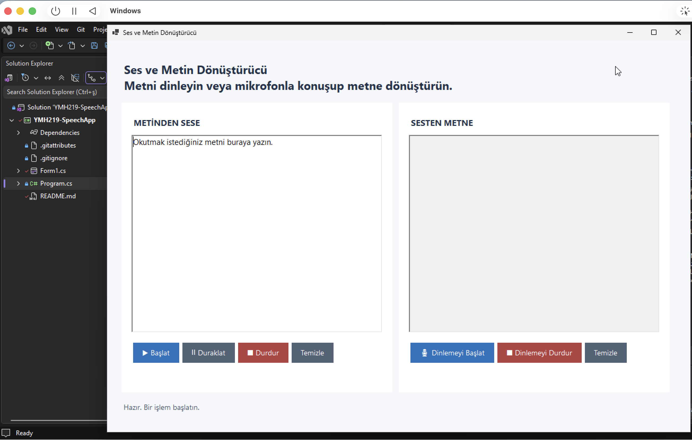
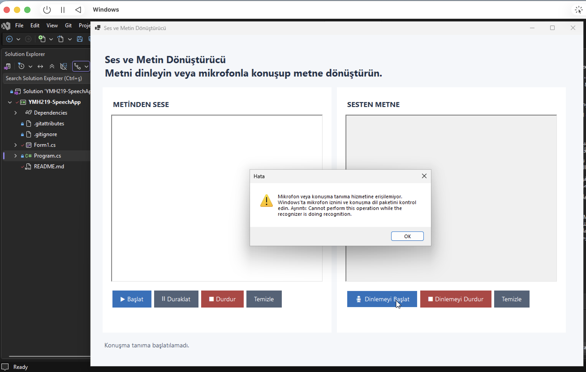

# 🎙️ YMH219 - SpeechApp

**Nesne Tabanlı Programlama (YMH 219)** dersi kapsamında **C#** ve **.NET 10 Windows Forms** kullanılarak geliştirilen, yazılı metni sesli okuyan (Text-to-Speech) ve mikrofondan alınan konuşmayı metne dönüştüren (Speech-to-Text) masaüstü uygulamasıdır.


## 📸 Ekran Görüntüleri

### Ana Pencere (Metinden Sese ve Sesten Metne)


### Hata Mesajı !



Bu proje, Windows konuşma servislerinin (`System.Speech`) masaüstü uygulamalarına entegrasyonu, sesli sentezleme, gerçek zamanlı konuşma tanıma, dosya kaydı ve hata yönetimi gibi konuları uygulamalı olarak göstermek amacıyla geliştirilmiştir.

---

## 🛠️ Kullanılan Teknolojiler ve NuGet Paketleri

* **Programlama Dili:** C#
* **Platform & Framework:** .NET 10 / Windows Forms (WinForms)
* **NuGet Paketleri:** `System.Speech` (Windows metinden sese ve sesten metne konuşma servisleri için)
* **Geliştirme Ortamı (IDE):** Visual Studio 2026
* **Sürüm Kontrolü:** Git & GitHub

---

## 🚀 Kurulum ve Çalıştırma Adımları

Projeyi yerel bilgisayarınızda çalıştırmak için aşağıdaki adımları izleyebilirsiniz:

1. **Gereksinimler:** Bilgisayarınızda **Windows 10/11** işletim sistemi ve **.NET 10 SDK** kurulu olmalıdır.
2. **Depoyu Klonlayın:**
   ```bash
   git clone [https://github.com/kullanici-adiniz/YMH219-SpeechApp.git](https://github.com/kullanici-adiniz/YMH219-SpeechApp.git)
   ```
3. **Projeyi Açın:**
   `YMH219-SpeechApp.slnx` dosyasını **Visual Studio 2026** ile açın.
4. **NuGet Paketlerini Geri Yükleyin:**
   Visual Studio'nun `System.Speech` başta olmak üzere gerekli NuGet paketlerini geri yüklemesini (Restore) bekleyin.
5. **Mikrofon İzinlerini Kontrol Edin:**
   Bilgisayarınıza bağlı bir mikrofon kullanın ve Windows gizlilik ayarlarından masaüstü uygulamalarının mikrofon erişimine izin verin.
6. **Derleyin ve Çalıştırın:**
   Visual Studio'da **Başlat** butonuna tıklayın veya `F5` tuşuna basarak uygulamayı başlatın.

---

## ✨ Uygulamanın Temel Özellikleri

* **Metinden Sese (Text-to-Speech):** Metin yazma, sesli okumayı başlatma/devam ettirme, duraklatma (Pause), durdurma (Stop) ve metni temizleme.
* **Sesten Metne (Speech-to-Text):** Varsayılan mikrofon aracılığıyla konuşmayı tanıma, tanınan sonuçları zaman damgasıyla (Timestamp) listeleme, dinlemeyi durdurma ve sonuçları temizleme.
* **Dışa Aktarma (Export):** Konuşma tanıma sonuçlarını `.txt` dosyası olarak bilgisayara kaydetme.
* **Kullanıcı Bildirimleri ve Hata Yönetimi:** Aktif işlem durumunu gösterme; mikrofon veya konuşma hizmeti hatalarında kullanıcıya anlaşılır uyarı mesajları sunma.

---

## 📝 Bilinen Sınırlamalar ve Geliştirme Notları

* **Konuşma Dili Bileşeni:** Konuşma tanıma özelliğinin çalışabilmesi için Windows'ta uygun bir konuşma dili / *Speech Recognition* bileşeninin kurulu ve kullanılabilir olması gerekir. Bu bileşen veya varsayılan bir mikrofon mevcut değilse uygulama kullanıcıya hata mesajı gösterir.
* **Platform Bağımlılığı:** `Windows Forms` ve `System.Speech` kullanıldığı için uygulama yalnızca Windows 10/11 işletim sistemlerinde çalışmaktadır.
* **Depo Notları:** Derleme çıktıları ve Visual Studio geçici dosyaları (`bin/`, `obj/`, `.vs/`) `.gitignore` dosyası aracılığıyla sürüm kontrolü dışında tutulmaktadır.

---

## 👨‍💻 Geliştirici Bilgileri

* **Ad Soyad:** [Enes Zukra]
* **Öğrenci Numarası:** [250541616]
